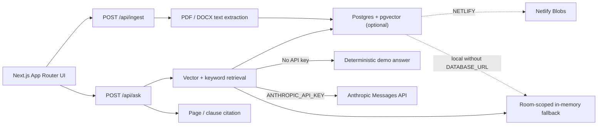

# Lexroom

Lexroom is a dark, source-first legal diligence workspace with a long-scroll marketing site and an interactive demo at `/app`. The demo starts with three fictional sample agreements and needs no API keys.

## Run locally

```bash
npm install
npm run dev
```

Open [http://localhost:3000](http://localhost:3000). `/` is the marketing site; `/app` is the working demo. PDF and DOCX uploads are limited to 20 files, 20 MB each. Local uploads use an in-memory room store and are lost when that process restarts. On Netlify, rooms persist in Netlify Blobs across function invocations.

## Optional configuration

Copy `.env.example` to `.env.local`:

| Variable | Purpose |
| --- | --- |
| `ANTHROPIC_API_KEY` | Enables answer generation from retrieved document excerpts. When absent, deterministic demo answers are used. |
| `ANTHROPIC_MODEL` | Optional Anthropic model override; defaults to `claude-3-5-haiku-latest`. |
| `DATABASE_URL` | Optional Postgres connection string. The API creates a room-scoped document/chunk schema and enables pgvector when the server has the `vector` extension installed. |
| `OPENAI_API_KEY` | Optional key for `text-embedding-3-small` embeddings when Postgres is configured. Without it, the configured Postgres index still uses keyword retrieval. |
| `ROOM_SESSION_SECRET` | Stable secret used to sign HttpOnly room-session cookies. If omitted, a random process secret is used and sessions expire on server restart. |

Never put secrets in client-side environment variables. The demo mode does not send documents to an external model.

## Architecture



Room IDs are random and bound to signed, HttpOnly, same-site cookies; API requests do not accept a client-selected room ID. This is browser-session isolation, not account sign-in or an organization-level authorization system. Before production use, add authenticated user/organization authorization, retention controls and audit logging that excludes document contents. No document text is written to application logs.

## Netlify

The `netlify.toml` configures the Next.js build. Set `ROOM_SESSION_SECRET` as a secret environment variable in the Netlify project's Functions scope; a stable value is required for signed sessions across serverless instances. Netlify Blobs automatically provides persistent storage for uploaded room documents. The no-key deployment uses deterministic demo answers.

The review view shows a pre-populated, cited comparison for the included sample room; newly uploaded documents appear in the room and are searchable, but require a configured production review pipeline before their cells can be considered analyzed. Do not rely on demo table cells as legal conclusions.

## Quality checks

```bash
npm run build
npm run eval
```

`npm run eval` runs 20 retrieval checks against the fictional bundled excerpts, including an out-of-scope question that must not produce a citation.

All output is AI-assisted, not legal advice. Verify against source.
